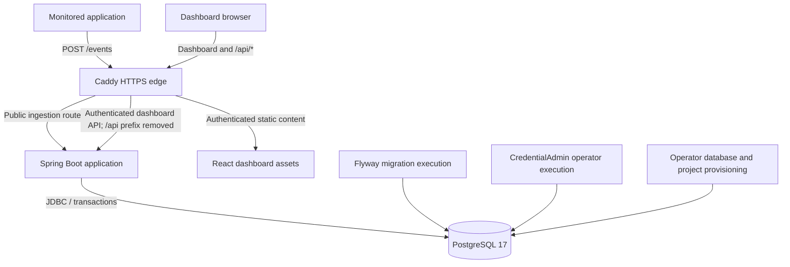

# TriageHarbor Architecture

> **Implementation reference:** `main` at `e2305b0` (November 16, 2026).
>
> This document describes the implemented system at that revision. It distinguishes enforced behavior from deferred functionality and does not treat architectural intentions as implemented guarantees.

## 1. Current System Overview

TriageHarbor is an incident-monitoring and error-tracking application built around a single Java/Spring Boot backend and a PostgreSQL database.

External applications submit error events through an authenticated ingestion endpoint. The backend sanitizes the event text, groups related occurrences into incidents, and stores each accepted occurrence. A separate React dashboard retrieves and displays incident summaries.

The system deliberately uses a small number of components. PostgreSQL provides the principal concurrency and integrity guarantees; Spring Boot implements the API, authentication, admission controls, event processing, and transaction boundaries.

There is no message broker, distributed worker system, or asynchronous ingestion pipeline in the current implementation.

### System topology



The diagram shows logical request and execution boundaries. Flyway, credential administration, and provisioning are operator-invoked execution modes or operations, not independently running application services.

### Major application responsibilities

| Component | Responsibility |
|---|---|
| `event` package | Ingestion HTTP boundary, credential resolution, rate limiting, scrubbing, fingerprinting, incident aggregation, and event persistence |
| `incident` package | Project-scoped incident retrieval and API response mapping |
| `project` package | JPA mapping of project metadata |
| Spring MVC | Request routing, JSON binding, validation, response serialization, and selected error handling |
| `JdbcTemplate` | Explicit SQL for implemented ingestion and read operations |
| PostgreSQL | Transactional persistence, uniqueness, referential integrity, and concurrency-safe aggregation |
| Flyway | Database schema evolution and runtime privilege grants |
| `CredentialAdmin` | Operator-only credential issuance, inventory, and revocation |
| React/Vite | Single-project dashboard and incident-summary presentation |
| Caddy | HTTPS termination, routing, dashboard Basic Auth, and static asset delivery |

Spring Data JPA is included, and entities map the core relational tables. However, the implemented ingestion and incident-read services use explicit JDBC queries rather than Spring Data repositories.

That distinction matters: Hibernate validates application mappings, while the SQL used by the ingestion service directly defines its write behavior.

## 2. Runtime and Deployment Boundaries

### Backend application

The backend uses Java 21 and Spring Boot 4.1.1.

`TriageHarborApplication` supports two execution modes selected through `TRIAGEHARBOR_MODE`:

- `serve` — starts the normal servlet application and exposes the HTTP endpoints.
- `migrate` — creates a non-web Spring application context, runs Flyway, verifies migration state, and exits.

The production Compose configuration disables Flyway in the normal backend service. Database migrations therefore do not occur as an uncontrolled side effect of regular serving startup.

The migration service uses the same backend image as the serving application but executes with migration privileges.

### Database

PostgreSQL 17.11 is the persistent data store.

The principal application tables are:

- `projects` — project identities and metadata.
- `project_ingest_credentials` — independently managed project ingestion credentials.
- `incidents` — grouped errors and occurrence aggregates.
- `events` — individual accepted error occurrences.

Flyway migrations V1–V4 define the database schema. V4 replaces the original project-level UUID ingest key with independently managed credentials.

Hibernate uses `ddl-auto=validate`; it does not create or evolve the production schema.

Database identities are separated by responsibility:

| Identity | Purpose |
|---|---|
| `triageharbor_admin` | PostgreSQL initialization and explicit role provisioning |
| `triageharbor_migrator` | Schema migrations, project provisioning, and operator credential operations |
| `triageharbor_app` | Restricted application runtime SQL |

The application role can read projects and credentials, read and update incidents as required for aggregation, and insert events. It cannot read raw events directly through its configured table privileges.

The role allowlist, relational constraints, and schema-evolution rules are specified in [Database Design](database.md). The Flyway SQL files remain authoritative for exact DDL.

### Frontend and edge

The frontend is a React/TypeScript application built with Vite and packaged into a Caddy-based container image.

The current dashboard targets one project ID configured at build time through `VITE_PROJECT_ID`. This identifier is public configuration, not an authentication credential.

Caddy is the only application service exposing host ports in the production Compose topology.

It:

1. Accepts HTTPS requests.
2. Forwards public `/events` ingestion traffic to Spring Boot without dashboard Basic Auth.
3. Applies deployment-level HTTP Basic Auth to `/api/*` requests.
4. Removes `/api` before forwarding those authenticated API requests to Spring.
5. Protects and serves the React application.

Caddy removes the deployment Basic Authorization header before proxying requests to Spring. The backend does not use that credential to establish a user identity.

The dashboard is same-origin: its static assets and backend API requests are served through the same public origin.

The application and PostgreSQL services communicate within the Compose network rather than exposing their ports directly to the production host.

### Production commissioning and deployment

`compose.prod.yaml` defines the persistent services and explicit operator workflows.

Initial commissioning follows this order:

1. Initialize PostgreSQL.
2. Bootstrap the restricted database roles.
3. Run Flyway migrations and verify the migration state.
4. Provision the frontend's configured project.
5. Issue the project's initial ingestion credential.
6. Start the normal backend and web services.

Project provisioning does not automatically issue credentials. The application can start without an active ingest credential, but fresh ingestion requests cannot authenticate until one exists.

The backend deployment uses an image identified by content digest. The frontend/edge image is configured through a commit-SHA-named tag.

GitHub Actions checks and publishes container images to GHCR. The inspected workflows do not automatically deploy those images to the production host.

**Deployment evidence:** Historical acceptance on November 19, 2026 verified fresh commissioning of commit `e2305b0` on a single DigitalOcean host. The exercised path included role bootstrap, Flyway V1–V4 migration verification, project provisioning, credential issuance, public HTTPS ingestion, credential rejection, Caddy route checks, and scoped revocation with a surviving primary credential. Dashboard login and incident visibility were operator-reported. This establishes a dated walking-skeleton acceptance, not current production state, continuous availability, live database ACLs, or untested failure behavior.

For exact operational procedures, see [Credential Operations](../prod/credential-operations.md).

### Historical TimeMetrics synthetic client path

A controlled synthetic TimeMetrics integration ran on November 19–20, 2026. The implementation remains on the unmerged branch `test/triageharbor-preview-ingest` at commit `f486828`. Its two intentional crash routes are demonstration code, not deployed production TimeMetrics application code and not authorization to forward real errors.

The inspected branch implements this path:

```text
Intentional Next.js server exception
        |
        +--> existing Sentry capture
        |
        +--> Node onRequestError
                  |
                  +--> exact message + routeType + routePath allowlist
                  +--> fixed occurredAt, exceptionType, message JSON
                  +--> one HTTPS POST to TriageHarbor /events
                         registered with Vercel waitUntil
```

The source establishes the following mechanisms:

- Sentry capture and TriageHarbor reporting are invoked independently, with synchronous and asynchronous Sentry failures contained from the TriageHarbor registration path.
- TriageHarbor reporting runs only when `NEXT_RUNTIME` is `nodejs` and a canonical Preview token is configured.
- A report is eligible only when the error message, framework route type, and framework route path exactly match one of the two fixed synthetic cases.
- The body contains only a new ISO `occurredAt`, a fixed `exceptionType`, and the fixed sentinel `message`. It does not serialize the original error, stack, request, headers, cookies, user identity, or URL.
- Delivery uses one `fetch` to `https://triageharbor.com/events`, a 2,500 ms abort signal, `redirect: "error"`, and no automatic retry.
- HTTP, network, timeout, response-cleanup, reporter-registration, and selected Sentry failures are reduced to controlled outcomes in the tested paths. Those tests do not prove universal containment for every platform shutdown, log sink, or arbitrary error object.
- The delivery promise is passed to Vercel `waitUntil` rather than awaited by `onRequestError`. This improves its opportunity to finish within the Function lifetime; it is not durable queuing or a delivery guarantee.

Deployment protection and credential scope are separate operational boundaries, not properties enforced by this source. Historical operator evidence indicates that the test used Vercel **Require Log In** and a dedicated branch-scoped Preview credential. Current Vercel configuration was not inspected. A fresh replay must verify protection and issue a new dedicated credential before deploying; the revoked November 2026 demonstration credential must never be reused.

Preserved screenshot evidence shows intentional application HTTP `500` responses, separate reporter HTTP `202` outcomes, persisted dashboard incidents, and positive Sentry capture. The handler incident increased from one to four occurrences while the render incident remained at one. These runtime observations are classified in [Testing and Verification](testing.md#historical-acceptance-evidence); source inspection alone does not establish that the historical deployment ran.

Avoiding client retries is deliberate. TriageHarbor has no client event identifier or deduplication constraint, so a timeout after a committed ingest is ambiguous. Retrying could record a second event and increment the incident again. Best-effort single-attempt delivery is therefore safer than automatic retry until retry-safe accounting exists.

## 3. Ingestion Request Flow

The public ingestion endpoint is:

`POST /events`

An accepted request includes:

- `Content-Type: application/json`
- `X-TriageHarbor-Ingest-Key: <credential>`
- JSON fields `occurredAt` and `message`
- Optional JSON fields `exceptionType` and `stackTrace`

The ingest credential authorizes event submission only. It grants no incident-reading or administrative capability.

The processing path is synchronous. A successful response is returned only after the writer has completed.

### Representative request

A monitored application submits:

```http
POST /events
Content-Type: application/json
X-TriageHarbor-Ingest-Key: <credential>
```

```json
{
  "occurredAt": "2026-11-19T12:00:00Z",
  "exceptionType": "java.lang.IllegalStateException",
  "message": "Database connection failed",
  "stackTrace": "at example.Service.load(Service.java:42)"
}
```

The request passes through the following boundaries.

### Step 1 — Global admission

`GlobalIngestRateLimitFilter` runs before request-body buffering and credential resolution.

It uses a Bucket4j token bucket with a monotonic time source.

An available token allows the request to continue. When the global quota is exhausted, the filter returns:

- HTTP `429 Too Many Requests`
- An empty response body
- A `Retry-After` header

The global token is consumed when admission succeeds, even if a later stage rejects the request.

The filter is registered for the servlet URL pattern `/events` without a method restriction, so every method on that path, including `OPTIONS`, spends a global token. Admission therefore depends on servlet path matching, not an exact comparison with the original request URI. Embedded-Tomcat routing tests cover path variants; Caddy may route those same incoming URLs differently. The path-test evidence is described in [Testing and Verification](testing.md).

This limiter protects the single application instance against excessive requests entering the more expensive ingestion path. It is not a distributed quota, a concurrency limit, or comprehensive denial-of-service protection.

### Step 2 — Request-size enforcement

`EventRequestSizeFilter` limits the backend request body to 256 KiB.

The filter reads at most one byte beyond the configured maximum to determine whether the body exceeds the limit. Accepted bodies are wrapped so Spring MVC can read the buffered content.

Oversized requests receive HTTP `413` and do not reach the controller.

Caddy independently configures a 256 KiB request-body limit on its public `/events` route. A request can therefore be rejected before reaching Spring.

The global admission filter runs ahead of the backend size filter. Consequently, an exhausted global bucket can return `429` before the backend evaluates the body size.

### Step 3 — JSON binding and validation

Spring MVC deserializes the request into `EventIngestRequest`.

Bean Validation requires:

- `occurredAt` to be non-null.
- `message` to be non-null.

`exceptionType` and `stackTrace` are optional.

Unknown JSON properties are ignored. In particular, a submitted `projectId` does not select the destination tenant.

The backend derives project identity exclusively from an authenticated ingest credential.

Malformed JSON, invalid timestamp values, and missing required fields are rejected before the controller performs credential resolution.

The controller has a specific unreadable-body exception handler that returns an empty `400` response and logs a fixed warning rather than the parsing exception's potentially unsafe message.

Other validation and framework errors retain their applicable Spring handling paths. The controller-local handler is not a universal sanitization mechanism for all HTTP errors.

### Step 4 — Credential authentication and project resolution

`IngestCredentialResolver` receives the raw `X-TriageHarbor-Ingest-Key` value.

The current credential lifecycle issues tokens with:

- Prefix `th_`
- 43 unpadded base64url characters
- 32 bytes of cryptographically secure random source material

The resolver first checks the header's permitted character and length format. It does not trim or normalize the token.

It then computes SHA-256 over the complete supplied token and queries:

```sql
SELECT project_id
FROM project_ingest_credentials
WHERE key_hash = ?
  AND revoked_at IS NULL
```

The database stores the credential hash rather than its raw token.

If an active matching credential exists, the resolver creates an `AuthenticatedProject` containing the resolved project UUID.

Missing, malformed, unknown, or revoked credentials receive HTTP `401` with an empty response body.

A credential database failure is not interpreted as an authentication failure. Database exceptions propagate to the controller's sanitized `500` handler.

**Trust boundary:** `AuthenticatedProject` represents an identity that the resolver has already established. It is an internal application object, not an independently signed authorization token.

Multiple active credentials may resolve to the same project, allowing overlapping credential rotation.

### Step 5 — Project-level admission

The controller passes the resolved project identity to `PerProjectIngestRateLimiter`.

The limiter uses a concurrent map of Bucket4j buckets keyed by project UUID.

This means:

- Different credentials for the same project share its quota.
- Different projects have separate project-level buckets.
- The client cannot select a rate-limit bucket by supplying an arbitrary project ID.

Exhaustion produces an empty HTTP `429` response with `Retry-After`.

The current quotas are configured through application properties. They are JVM-local and reset when the process restarts. Their configured values are admission policy, not evidence of measured system capacity.

Only requests admitted by both limiters proceed to persistence.

### Step 6 — Transactional event processing

`EventIngestController` calls the Spring-managed `EventIngestService.ingest()` method.

That method is annotated with `@Transactional`.

Its first statement creates a sanitized event representation:

```java
RedactedEvent redactedEvent = RedactedEvent.from(request);
```

This placement ensures that subsequent fingerprinting, incident-title derivation, and persistence all use scrubbed event text.

The writer then:

1. Obtains the resolved project UUID.
2. Captures one server-controlled receipt timestamp from an injectable `Clock`.
3. Computes the version-2 fingerprint.
4. Derives a title from sanitized text.
5. Atomically creates or updates the matching incident.
6. Inserts the sanitized event row referencing the returned incident ID.

#### Sensitive-data scrubbing

`SensitiveDataRedactor` applies deterministic pattern-based replacements, in this order:

1. URL userinfo passwords
2. JWT-shaped values
3. Sensitive assignments and headers
4. Recognized TriageHarbor ingest-credential-shaped tokens

Covered values are replaced with `[REDACTED]`.

The fields passed through this boundary are `exceptionType`, `message`, and `stackTrace`.

The sender-provided `occurredAt` is preserved as the event's reported occurrence time.

Scrubbing is deliberately performed before data is used to derive other persistent values. Otherwise, sensitive text could survive indirectly in an incident title or fingerprint input even if the event row itself had been sanitized.

This is **pattern-based protection, not comprehensive secret or personal-information removal**. Unrecognized formats, transformed secrets, and data encountered before the service scrubber remain potential exposure paths.

#### Fingerprint generation

`EventFingerprintV2` computes a SHA-256 fingerprint from sanitized `exceptionType` and `message`.

The encoding is length-delimited, handles null fields explicitly, and uses UTF-8 bytes. `stackTrace` and timestamps do not participate in the fingerprint.

Version 2 preserves the hash-encoding approach of version 1. The version changed because expanded credential-aware redaction changed the semantic input representation.

No additional normalization of variable values, generated identifiers, timestamps embedded in messages, or changing line numbers is currently implemented.

An incident is identified by:

```text
(project_id, fingerprint_version, fingerprint)
```

Different fingerprint versions intentionally represent distinct identities. Historical incidents are not automatically recomputed or merged.

#### Incident aggregation

The writer uses a single PostgreSQL `INSERT ... ON CONFLICT DO UPDATE ... RETURNING id` statement. It creates the incident if none exists. Otherwise it increments the stored occurrence count inside PostgreSQL and widens the first/last-seen range, avoiding an application-side read-modify-write race. The unique incident identity lets concurrent successful ingests aggregate into one row instead of failing on duplicate creation, and `RETURNING id` supplies the incident ID for the event insert either way.

The exact SQL semantics are documented in [Database Design — Atomic Incident Aggregation](database.md#5-atomic-incident-aggregation).

The current UPSERT does **not** change incident status.

A new incident defaults to `open`. If a previously resolved incident receives another matching occurrence, the current writer increments its count and updates timestamps without reopening it.

The incident title is also a creation-time snapshot; subsequent matching occurrences do not replace it.

#### Event persistence

After obtaining the incident ID, the writer inserts a new event containing:

- The authenticated project ID
- The returned incident ID
- The client-reported `occurred_at`
- The server-controlled `received_at`
- Sanitized exception type, message, and stack trace

The same captured `received_at` value is used by the incident aggregation and the event row.

`occurred_at` is untrusted client-reported time. It does not drive the aggregate's first-seen or last-seen timestamps.

PostgreSQL's composite foreign key prevents an event from claiming one project while referencing an incident belonging to another.

### Step 7 — Transaction completion and HTTP response

The incident UPSERT and event INSERT execute within the writer's database transaction.

If both operations succeed and the transaction commits, the controller returns:

`202 Accepted`

The response body is empty.

If the event insert fails after the incident has been created or updated, the transaction rolls back both writes.

No partial incident-count update is intentionally committed without its corresponding event insert.

**HTTP `202` here indicates completed synchronous persistence, not acceptance into a background queue.** The application does not defer persistence to a worker.

The database transaction and its rollback behavior are described further in [Database Design](database.md), with the corresponding integration evidence in [Testing and Verification](testing.md).

## 4. Read Path and Authorization

The implemented read endpoint is:

`GET /projects/{projectId}/incidents`

It returns incident summaries for the supplied project UUID.

In the production Caddy configuration, the React dashboard sends the request through the same-origin path:

`GET /api/projects/{projectId}/incidents`

Caddy checks the dashboard Basic Auth credentials, strips `/api`, and forwards the request to the Spring backend.

### Backend read flow

`IncidentReadController` delegates to `IncidentReadService`.

The service first checks whether the project exists. An absent project produces HTTP `404`.

For an existing project, it executes a project-scoped query with:

```sql
WHERE project_id = ?
ORDER BY last_seen_at DESC, id DESC
LIMIT 100
```

The ordering puts the most recently seen incidents first, with UUID ordering as a deterministic tie-breaker.

An existing project with no incidents returns `200 []`.

A malformed UUID path parameter is rejected by Spring as `400`.

The service maps the selected database fields into immutable `IncidentSummary` records, which Spring serializes to JSON.

The response includes:

- Incident ID
- Title
- Status
- Occurrence count
- First-seen timestamp
- Last-seen timestamp

It does not expose raw event messages, stack traces, fingerprints, or credential records.

The frontend validates the received response contract and renders loading, error, empty, and incident-list states.

### SQL scoping is not user authorization

The read SQL includes `WHERE project_id = ?`, preventing the query from intentionally returning rows from other project IDs.

However, the Spring endpoint does not authenticate an application user or verify that the caller owns the requested project.

The configured production edge security boundary is Caddy Basic Auth.

Once a caller passes that deployment-level check, the backend does not independently determine which project UUIDs that caller may request.

The ingest credential is also not a read credential. Supplying one does not establish read authorization.

This distinction is important:

- **SQL project scoping** constrains which rows a query selects.
- **Authorization** determines whether the caller is entitled to request those rows.

The first is implemented. Project-level read authorization is deferred.

The read implementation also performs project existence checking and incident retrieval as separate SQL statements, without an explicit shared read snapshot. A concurrent project deletion can theoretically change the state between those statements.

Pagination is not implemented. The current API returns a maximum of 100 summaries.

## 5. Transaction and Failure Boundaries

### Ingestion transaction scope

The principal writer transaction begins when the Spring-managed `@Transactional` service method is invoked.

Inside it are:

- Event text scrubbing
- Fingerprint and title derivation
- Receipt-time capture
- Incident UPSERT
- Event INSERT

Credential resolution and both rate-limit decisions happen outside that writer transaction.

This separation prevents credential lookup and admission work from being unnecessarily included in the incident/event persistence transaction.

It also defines the point at which authorization is established.

The writer receives an already-resolved project identity and does not re-read the originating credential.

### Database guarantees versus application guarantees

| Concern | Primary enforcement |
|---|---|
| Credential shape and active-credential lookup | Application resolver plus database query |
| Request admission | JVM-local Bucket4j limiters |
| Scrubbing before derived or stored event text | Application writer's processing order |
| Incident identity uniqueness | PostgreSQL unique constraint |
| Concurrent occurrence-count updates | PostgreSQL atomic conflict update |
| Incident and event rollback together | Spring transaction backed by PostgreSQL |
| Project/incident/event relationship integrity | PostgreSQL foreign keys |
| Runtime database privileges | PostgreSQL role grants |
| Dashboard access through production edge | Caddy Basic Auth |
| Project ownership authorization for reads | Not implemented |

The important distinction is that admission and sanitization are application responsibilities, whereas correctness under concurrent incident writes relies on PostgreSQL.

### Connection-retention tradeoff

The application uses a Spring-managed transaction manager with JPA integration even though the operational writer uses JDBC.

`EventIngestConnectionRetentionTests` establishes that, in its tested Hikari/JPA configuration, the transaction acquires and retains a physical database connection before the callback issues its first SQL statement.

As a result, the writer's scrubbing and fingerprint computation may execute while a database connection is already checked out.

This is a real architectural tradeoff. The scrubber is deliberately inside the transactional writer to preserve a single sanitization boundary, but CPU work may occupy a connection.

The test establishes connection-retention behavior. It does not establish a production performance bottleneck. Any optimization should follow measurement of connection-pool occupancy and ingestion latency.

### Credential revocation timing

Credential revocation updates the stored credential state independently of the ingestion writer transaction.

A fresh lookup after revocation commits against the same primary database rejects the revoked credential.

However, a request that resolved its project identity before revocation committed may still persist its event afterward.

This follows from the separation between credential resolution and the transactional writer: the writer receives the resolved project ID and does not revalidate the credential.

The inspected `CredentialRevocationInFlightTests` exercises that behavior with a deterministic resolve–revoke–write sequence. Fully concurrent revocation during the writer's active transaction and an upper bound on the in-flight window are not established.

Revocation therefore prevents new authentication; it is not cancellation of previously authorized work.

### Credential administration transaction boundaries

`CredentialAdmin` is a standalone Java entry point, separate from the Spring web application.

It performs packaged Flyway-state verification before credential operations and uses the migrator identity.

Supported operations are issuance, metadata inventory, and revocation.

For mutations, the CLI locks the project row using `FOR NO KEY UPDATE` under `READ COMMITTED` isolation.

This serializes cooperating operator mutations on a project without taking the stronger `FOR UPDATE` lock that would unnecessarily conflict with some ingestion foreign-key checks.

The last-active-credential guard requires explicit `--force-last` when an operator intends to revoke the final active key. This protection is cooperative CLI behavior, not an independently enforced database constraint against every possible database writer.

**Issuance:** A newly generated credential is committed before its raw token is printed to stdout. The raw token is intended to be emitted once. If the commit outcome or output delivery is uncertain, issuance must not be blindly retried; a replacement and revocation recovery procedure is required.

**Revocation:** Repeating a successful scoped revoke is supported without changing the original revocation timestamp. Uncertain commit outcomes require reconciliation through the same scoped command and the documented recovery procedure.

External interactions and output delivery are not held inside the database mutation transaction after confirmed commit.

For exact commands, output handling, failure recovery, and operational safety, see [Credential Operations](../prod/credential-operations.md).

### Request failures and retry consequences

The current failure behavior is intentionally bounded:

| Failure | Current behavior |
|---|---|
| Global rate limit exceeded | `429`, before body buffering |
| Request body exceeds backend limit | `413`, before controller processing |
| Malformed JSON or invalid required fields | `400`, before credential resolution |
| Missing, malformed, unknown, or revoked credential | `401` |
| Project quota exceeded | `429`, before persistence |
| Database access or transaction exception handled by the ingestion controller | `500` with an empty body and class-only error logging |
| Failure during incident/event transaction | Transaction rollback |
| Lost HTTP response after successful commit | Outcome ambiguous to the client |

The controller-local exception handlers intentionally avoid printing untrusted database exception messages.

The datasource also sets `logServerErrorDetail=false` to reduce sensitive PostgreSQL error details appearing in rendered JDBC exceptions. This is not a guarantee about every server-side log, diagnostic sink, or structured exception field.

Other framework and infrastructure failure paths are not universally covered by these handlers.

### Repeated submissions and idempotency

Every successful ingestion is treated as a new occurrence.

If a client sends the same event twice and both requests commit:

- The matching incident remains one row.
- Its occurrence count increases twice.
- Two event rows are appended.

There is no client event identifier, ingestion deduplication constraint, or retry-idempotency mechanism.

A network failure or timeout can occur after the database commits but before the client receives the response. The client cannot infer from the timeout whether the event was stored.

Retrying such a request may create an additional occurrence.

Therefore, TriageHarbor currently guarantees neither exactly-once ingestion nor retry-idempotent occurrence counts.

This is independent of the concurrency guarantee: **the system prevents lost concurrent increments, but it intentionally counts separate successful submissions separately.**

## 6. Key Design Tradeoffs

### Database-centered concurrency instead of application coordination

The incident writer relies on a unique constraint and atomic PostgreSQL UPSERT rather than application-side locking or read-modify-write logic.

This keeps correctness in the data store shared by all transactions. It also means concurrent occurrences of one incident contend on the same database row.

The inspected integration tests exercise 50 concurrent calls for both new-incident creation and existing-incident updates, against real PostgreSQL. The November 16 backend CI logs show those tests passing.

These tests establish the specified outcomes for the exercised single-JVM topology. They do not independently verify multi-instance deployment behavior, sustained throughput, or every saturation scenario.

### Explicit SQL while retaining JPA validation

The project includes Hibernate/JPA mappings but uses `JdbcTemplate` for the operational ingest and read paths.

This provides direct control over PostgreSQL-specific SQL, particularly `ON CONFLICT ... RETURNING`, while retaining mapping validation against Flyway-managed schema.

The tradeoff is that SQL and JPA mappings require deliberate consistency. Hibernate validation alone does not prove runtime privileges, constraints, or transaction correctness.

### Synchronous persistence instead of a queue

The current endpoint writes incidents and events before responding.

This keeps transaction and failure behavior relatively straightforward: either the incident/event transaction commits, or it rolls back.

The tradeoff is that ingestion latency depends on the database transaction and that the HTTP request does not have a durable buffer independent of PostgreSQL.

There is no background retry or worker recovery system for accepted-but-unprocessed tasks because no asynchronous work is currently accepted.

### JVM-local admission instead of distributed rate limiting

Bucket4j provides global and project-level controls without introducing Redis or another shared dependency.

The implementation limits work entering a single JVM, but multiple JVMs would maintain independent buckets.

Quotas do not persist across restarts and do not provide a distributed aggregate limit.

This is a deliberate simplicity tradeoff for the current deployment.

### Hashed, operator-managed ingest credentials

Credentials use high-entropy random token material and a database-stored SHA-256 digest.

This avoids storing retrievable raw credentials while permitting active-key lookup and overlapping rotation.

The tradeoff is operational: raw tokens cannot be recovered after issuance. Failed output delivery and uncertain commits require deliberate recovery, and credential administration remains an operator workflow rather than a self-service API.

### Deployment-level dashboard protection

Caddy Basic Auth provides a small access boundary without prematurely implementing a full user-management system.

The tradeoff is that the backend does not yet enforce per-user or per-project permissions for reads.

This boundary is appropriate to describe as temporary deployment access control, not multi-tenant authorization.

### Versioned fingerprint semantics

Fingerprint versions preserve the interpretation of existing incident identities when derivation rules change.

The tradeoff is that a logically similar error may appear in separate incidents across versions.

Automatic reconciliation is deferred rather than silently rewriting historical identities.

## 7. Current Limitations and Deferred Capabilities

### Incident lifecycle

The database recognizes `open` and `resolved` statuses, but the inspected HTTP interface does not implement incident-state mutation.

The ingest UPSERT does not reopen resolved incidents.

The intended resolved-to-open regression behavior, including a concurrency-safe single logical transition, remains deferred.

### Event investigation

Events are persisted but there is no event-detail or incident-event listing endpoint.

The dashboard exposes incident summaries rather than individual stack traces or event histories.

There is no incident pagination or project-selection UI.

### Authorization

Application-level user authentication and project-ownership authorization for privileged reads are not implemented.

A caller who passes Caddy's Basic Auth can request an arbitrary project UUID through the read API.

Direct backend access outside that edge would not inherit Caddy's protection.

### Additional ingestion route through `/api/events`

The current Caddy configuration uses `handle_path /api/*`, removing `/api` before proxying to Spring.

As a result, an authenticated request to:

`POST /api/events`

can reach Spring's `/events` ingestion controller after passing dashboard Basic Auth. It still requires a valid ingestion credential.

This creates an additional effective ingestion route, even though the intended public entry point is `/events`.

The Spring servlet filters still apply to the forwarded `/events` path, including the backend size limit and admission controls.

However, the Caddy-specific request-body limit configured for public `/events` does not apply to the `/api/*` handler.

Historical acceptance testing showed an authenticated `POST /api/events` being forwarded by Caddy to Spring's `/events` controller and returning backend `401` without an ingest key. Successful persistence through this alias was not attempted. Embedded-Tomcat path tests remain separate from that dated edge observation.

Restricting `/api/*` to the intended read methods is a deferred edge change. Until then, documentation should not claim that `/events` is the only route capable of reaching ingestion.

### Privacy and diagnostic coverage

The scrubber covers recognized patterns, not arbitrary sensitive information.

Parsing and validation may fail before the scrubber runs. Different logging configurations, external sinks, and newly introduced validators require further review.

Successful synthetic-data tests do not establish that unrestricted production error payloads are safe to collect.

### Retention and event identity

There is no implemented event-deduplication key or retry-safe event accounting.

Automatic event retention, partitioning, and historical event replay are deferred.

The event model remains append-oriented, with no generic raw JSON payload or event-history API.

### Background processing

No durable queue, worker leasing, notification delivery, webhook processing, or retry scheduler is implemented.

Such components should be introduced against an actual requirement with explicit transaction, retry, duplicate-execution, and failure-recovery contracts.

They are not part of the present runtime architecture.

### Observability and scale

The application records Micrometer ingestion-rejection counters, including global and project-limit reasons.

The production Compose configuration exposes Actuator health only; it does not expose those counters as a public management endpoint.

The inspected runtime contains no implemented distributed tracing pipeline, Prometheus/Grafana deployment, or durable operational metrics system.

The production Compose architecture is single-host and configures one backend service instance. The current deployed replica count was not inspected. Multi-instance request behavior, cross-instance admission, sustained ingestion throughput, and incident-row hotspot capacity are not established by the reviewed evidence.

Performance changes should follow measurement rather than assumed scaling needs.

### Deployment and client integration

CI validates and publishes images, but does not automatically roll them out to the production host.

November 19 production acceptance established a dated synthetic walking skeleton covering fresh commissioning, public HTTPS ingestion, dashboard visibility, credential rejection and revocation, and the tested Caddy routes. It did not establish continuous availability, production load performance, current external state, or the production cases left untested.

The later TimeMetrics demonstration supplies a separate dated synthetic client result for protected Vercel-to-TriageHarbor delivery, dashboard persistence and grouping, and parallel Sentry capture, subject to the evidence limitations recorded in [Testing and Verification](testing.md#historical-acceptance-evidence).

That exercise did not approve arbitrary real-error collection or establish an always-on TimeMetrics integration. Production capture still requires an explicit privacy and disposability decision, safe handling of React-processed messages and stacks, redaction and truncation tests for arbitrary payloads, and an approved capture scope.

Client integration must preserve the monitored application's reliability: reporting is best effort, must not block user-facing work, and must not introduce automatic retries before retry-safe event accounting exists.

---

## Related Documentation

- [README](../README.md) — project overview, quick start, and engineering highlights.
- [Database Design](database.md) — schema, integrity constraints, atomic aggregation, and database privileges.
- [Testing and Verification](testing.md) — integration evidence, concurrency and failure tests, and verification limits.
- [TimeMetrics Synthetic Demo Runbook](timemetrics-demo-runbook.md) — controlled replay, evidence capture, credential isolation, and cleanup.
- [Frontend Development](../frontend/README.md) — local React dashboard setup.
- [Local PostgreSQL](../dev/postgres/README.md) — local database bootstrap and reset considerations.
- [Credential Operations](../prod/credential-operations.md) — production issuance, rotation, revocation, and recovery.
